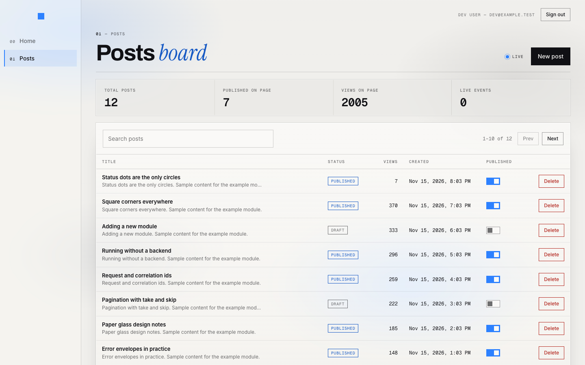

# svelte-frontend-template

A starting point for the micro frontends of a home dashboard. Each module (TV, Car, Lab, Files and so on) runs on its own subdomain, such as `tv.dashboard.example`, and can also be mounted inside a shell app. Copy `apps/example` to start a new module.

It pairs with a Go backend template that serves REST, keeps sessions in Redis and pushes live events over SSE.



## Stack

Svelte 5 (runes only), SvelteKit 2 with `adapter-static` in SPA mode, TypeScript strict, Vite, pnpm workspaces. Live data uses SSE through `EventSource`. Tests use Vitest, Testing Library and Playwright.

## Layout

```
apps/shell        splash, session, nav rail and the module loader
apps/example      the Posts module, standalone SPA plus dist/module/module.js
packages/ui       paper glass tokens, fonts and Svelte components
packages/sdk      API client, ApiError, SSE client, session and scopes, module types
packages/mock     Vite plugin with the mock API, used in dev, preview and e2e
scripts/          new-module.sh
e2e/              Playwright specs, run against mock mode
docker/           nginx config used by the Dockerfile
```

## Commands

Node 24 and pnpm are required (`npm i -g pnpm`).

| Command        | What it does                                                           |
| -------------- | ---------------------------------------------------------------------- |
| `pnpm install` | Install all workspaces                                                 |
| `pnpm dev`     | Shell on :5173 and Posts on :5174, both in mock mode                   |
| `pnpm lint`    | Prettier check and ESLint                                              |
| `pnpm check`   | svelte-check and tsc, no errors or warnings allowed                    |
| `pnpm test`    | Unit and component tests                                               |
| `pnpm build`   | Builds every app, including the module build                           |
| `pnpm e2e`     | Playwright against `vite preview` in mock mode. Run `pnpm build` first |
| `pnpm format`  | Prettier write                                                         |

Run one app with `pnpm --filter @dashboard/example dev`. Add `PUBLIC_MOCK=1` to use the mock API.

## Micro frontend contract

Each module builds twice:

- `vite build` makes the standalone SPA in `dist/app`.
- `vite build --config vite.module.config.ts` makes `dist/module/module.js`, one ES module with its CSS injected.

`module.js` exports:

```ts
mount(target: HTMLElement, ctx: ModuleContext): { unmount(): void }
```

`ModuleContext` lives in `packages/sdk`:

```ts
{ apiBase: string; user: User; navigate(path: string): void; theme: 'light' | 'dark' }
```

The shell shows the splash, loads the session and the manifest, and keeps only the entries whose `scope` is in `user.features`. When a route like `/posts` opens, it calls `import(/* @vite-ignore */ url)`, mounts the module into a container and unmounts it on the next route change. The shell provides the global tokens and fonts, so `module.js` carries only component styles.

The manifest is a JSON list of `{ id, title, url, scope }`. The shell reads `PUBLIC_MANIFEST_URL`, which defaults to `/manifest.json`.

| File                                  | Points at                                    | Used by             |
| ------------------------------------- | -------------------------------------------- | ------------------- |
| `apps/shell/static/manifest.dev.json` | `http://localhost:5174/src/module.ts` (dev)  | `pnpm dev`          |
| `apps/shell/static/manifest.json`     | `http://localhost:4174/module/module.js`     | preview and e2e     |
| `apps/shell/manifest.example.json`    | `https://posts.dashboard.example/module/...` | copy for production |

In dev the shell imports the module source straight from the example's Vite server, which sends CORS headers for localhost. To test the real bundle, run `pnpm build`, then `PUBLIC_MOCK=1 pnpm --filter @dashboard/example preview` and `PUBLIC_MOCK=1 pnpm --filter @dashboard/shell preview`. The example preview serves `dist/module` at `/module/` with CORS.

In production, mount your own `manifest.json` into the shell container at `/usr/share/nginx/html/manifest.json`.

## Backend contract

- Base URL comes from `PUBLIC_API_BASE`. Empty means same origin. Requests send cookies.
- Every request sends `X-Request-ID` (a fresh UUID v7) and `X-Correlation-ID` (one per page load, or one per user action for writes). Both are read back from the response.
- Errors use one envelope and the matching HTTP status:

  ```json
  {
    "requestId": "...",
    "correlationId": "...",
    "errors": [
      {
        "code": "E422-1",
        "message": "Validation failed",
        "customerActions": ["..."],
        "supportActions": ["..."],
        "fields": [{ "field": "title", "rule": "min", "message": "..." }]
      }
    ]
  }
  ```

  The sdk throws `ApiError` with `status`, `code`, `message`, `fields`, `requestId` and `correlationId`. Network failures become `ApiError` with status 0.

- Lists return `{ items, total, take, skip }` and take `?take=&skip=`.
- Session: `GET /api/v1/session` returns `{ user }` or 401. `features` holds scopes such as `posts:read`. `POST /api/v1/session/dev-login` works on localhost only. `DELETE /api/v1/session` signs out.
- Posts: `GET /api/v1/posts?take&skip&published&q`, `POST /api/v1/posts`, `GET|PATCH|DELETE /api/v1/posts/{id}`.
- SSE: `GET /api/v1/events?topics=posts,alerts`. Each event has `event: posts.created`, `id: <stream id>` and a JSON `data` envelope `{ topic, type, id, data, correlationId, at }`. The server sends `: ping` every 15 seconds and the browser resends `Last-Event-ID` on reconnect.

`EventStream` in the sdk subscribes by topic with typed handlers, exposes `status` (`connecting`, `open`, `closed`) as a rune, backs off when the connection closes, and stops for good on `close()`.

## Mock mode

Set `PUBLIC_MOCK=1` and the `mockApi()` Vite plugin answers `/api/*` in dev and preview. No backend is needed.

- Twelve seeded posts, kept in memory per server.
- Dev login sets an `sid` cookie. Scopes are enforced: 401 without a session, 403 without the scope.
- Validation follows the backend: a title under 3 characters returns 422 with field errors.
- `/api/v1/events` streams `posts.created`, `posts.updated` and `posts.deleted`, pings every 15 seconds and replays from `Last-Event-ID`.

Open two tabs on the same app, create a post in one and it appears in the other.

## Add a module

```sh
sh scripts/new-module.sh tv 5175
pnpm install
pnpm --filter @dashboard/tv dev
```

The script copies `apps/example` to `apps/tv`, renames the package, module id, title and ports, and prints the manifest entry to add. Then replace `src/lib/posts` with the real feature and set the scopes and topics in `src/lib/module-info.ts`. Keep `src/module.ts` as it is.

## Design rules

The look is paper glass. Tokens live in `packages/ui/src/tokens`.

- Light theme on warm paper `#F2F1EE`, raised surfaces `#FAF9F7`, ink `#101014`.
- One blue accent: `#2D81FF` for fills and live, `#1659C4` for text. Danger is `#B3261E`. No orange anywhere.
- Colour means something needs a look. Healthy is ink.
- Square corners everywhere. Status dots are the only circles.
- Frosted glass panels (`blur(28px) saturate(180%)`) sit over soft blue and ink colour fields with faint scanlines. Never glass on glass.
- Archivo for display, one Instrument Serif italic word per headline, Inter for body, Geist Mono for numbers and 10 px uppercase labels such as `01 — Posts`.
- Fonts are self-hosted through `@fontsource`, so the app works on a LAN without a CDN.
- Everything reads CSS variables, so a dark theme can be added later by overriding them.

Components: `Panel`, `Eyebrow`, `Button`, `Input`, `Textarea`, `Toggle`, `Stat`, `Table`, `Badge`, `StatusDot`, `Toast` with `Toaster` and `ToastStore`, `Drawer`, `EmptyState`, `Splash` and `DevLogin`.

## Docker

One image per app, picked with `APP`:

```sh
docker build --build-arg APP=example -t dashboard-posts .
docker build --build-arg APP=shell -t dashboard-shell .
docker run -p 8080:8080 dashboard-posts
```

nginx serves the SPA with a fallback to `index.html`, caches `/_app/immutable/` for a year, sends `no-cache` for everything else, and serves `/module/module.js` with CORS so the shell can load it from another subdomain. The container runs as UID 101 and has a health check on `/healthz`.

## License

MIT
